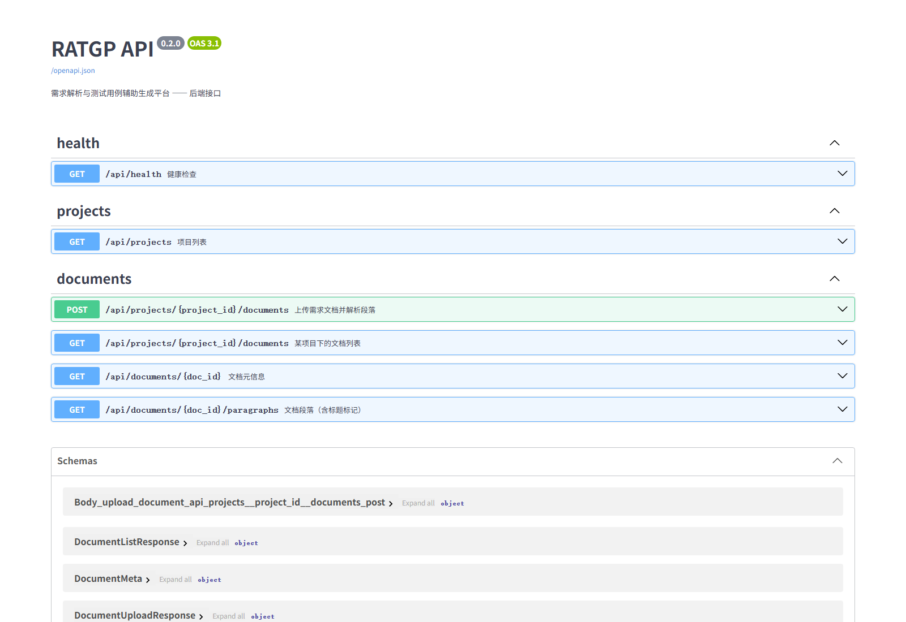

# RATGP API（P2）

FastAPI 后端，跑在 **8000** 端口，前端（`Web/`，Next.js）通过 HTTP 调它。P2 只做「文档上传 + 解析」这一条链路，其余接口后续按 P3–P8 补。

## 启动

```powershell
cd C:\Users\Pyz18\Desktop\Project\Software_Engineering_Project
.\venv\Scripts\python.exe -m uvicorn App.api.main:app --reload --port 8000
```

- 文档：http://127.0.0.1:8000/docs （FastAPI 自带的 Swagger，可直接上传文件试）
- 健康检查：http://127.0.0.1:8000/api/health

依赖已经在 `venv` 里（fastapi / uvicorn / python-multipart / python-docx）。换机器时：

```powershell
.\venv\Scripts\python.exe -m pip install -r App\requirements.txt
```

## 接口

| 方法 | 路径 | 说明 |
|---|---|---|
| GET | `/api/health` | 健康检查，顺带返回项目数 |
| GET | `/api/projects` | 项目列表（带需求条数） |
| POST | `/api/projects/{project_id}/documents` | 上传并解析文档（multipart：`file` + `version`） |
| GET | `/api/projects/{project_id}/documents` | 该项目下的文档列表 |
| GET | `/api/documents/{doc_id}` | 文档元信息（段落数、字符数、原始文件路径） |
| GET | `/api/documents/{doc_id}/paragraphs` | 段落列表（含 `style` 与 `is_heading`） |

### 上传示例

```powershell
# Windows PowerShell 5.1 用 curl.exe（Invoke-RestMethod -Form 要 PowerShell 7+）
curl.exe -X POST http://127.0.0.1:8000/api/projects/1/documents `
  -F "file=@test_file/datasets/course_selection_v1.docx" `
  -F "version=V1.0"
```

或者直接打开 http://127.0.0.1:8000/docs ，在 `POST /api/projects/{project_id}/documents` 里点 **Try it out** 选文件上传。

实测（`test_file/datasets/course_selection_v1.docx`）：52 段、1071 字符、段落 0 为 `Heading 1`、段落 2 为 `Heading 2`（`CR-001 登录认证`）。



返回：

```json
{
  "document": {
    "doc_id": 1, "project_id": 1, "filename": "course_selection_v1.docx",
    "version": "V1.0", "upload_time": "2026-11-09 11:20:31",
    "paragraphs": 52, "chars": 1071, "file_path": "App/data/uploads/<uuid>.docx"
  },
  "paragraphs": [
    { "para_no": 0, "text": "校园选课系统需求说明书 V1.0", "style": "Heading 1", "is_heading": true }
  ]
}
```

## 错误码约定

| 码 | 场景 |
|---|---|
| 400 | 空文件、解析失败、没有可解析文本、版本号过长 |
| 404 | 项目 / 文档不存在 |
| 413 | 超过大小上限（默认 10 MB） |
| 415 | 扩展名不是 `.docx` / `.txt` |
| 500 | 落盘或入库失败（同时会清理临时文件） |

## 实现要点

1. **先落盘再解析**：文件存到 `App/data/uploads/<uuid>.<ext>`，DB 的 `Document.file_path` 指向它 —— 保留原始文件，后面版本比对和「重新解析」都用得上。
2. **失败即清理**：解析失败、入库失败、超限、空文件，都会 `unlink` 掉刚落盘的文件，不留垃圾。
3. **复用服务层**：解析走 `App/services/doc_service.py`，不在这层重写 docx/txt 的逻辑；`para_index` 额外带 `style`，前端据此渲染大纲与标题。
4. **测试可隔离**：`App/dao/db.py` 的 `DB_PATH` 支持 `RATGP_DB` 覆盖，测试用临时库，不碰 `App/data/ratgp.db`。

## 环境变量

| 变量 | 默认 | 说明 |
|---|---|---|
| `RATGP_DB` | `App/data/ratgp.db` | SQLite 路径 |
| `RATGP_DATA_DIR` | `App/data` | 数据目录 |
| `RATGP_UPLOAD_DIR` | `App/data/uploads` | 上传文件目录 |
| `RATGP_MAX_UPLOAD_MB` | `10` | 单文件大小上限 |
| `RATGP_CORS` | `localhost/127.0.0.1:3000,3100` | 逗号分隔的允许来源 |

## 测试

```powershell
.\venv\Scripts\python.exe -m unittest discover -s App\api\tests -v
```

覆盖：段落数与样式、非法扩展名、路由注册、上传 → 元信息 → 段落回读、404/415/400 三类错误。

## 下一步（P2 前端）

后端这条链路已经通了，前端 `Web/` 还差三块：

1. `/document` 页面：上传区（拖拽 + 版本号）→ 调 `POST /api/projects/1/documents`；
2. 左栏段落大纲、中间原文、右侧候选需求（候选需求要等 P3 的抽取接口，先静态占位）；
3. 把 `App/services/llm_service.py` 包一层 `POST /api/requirements/extract`，文档与需求才会真正联动。

在此之前，`Web/` 的运行不依赖这个服务（P1 用的是 mock）。

